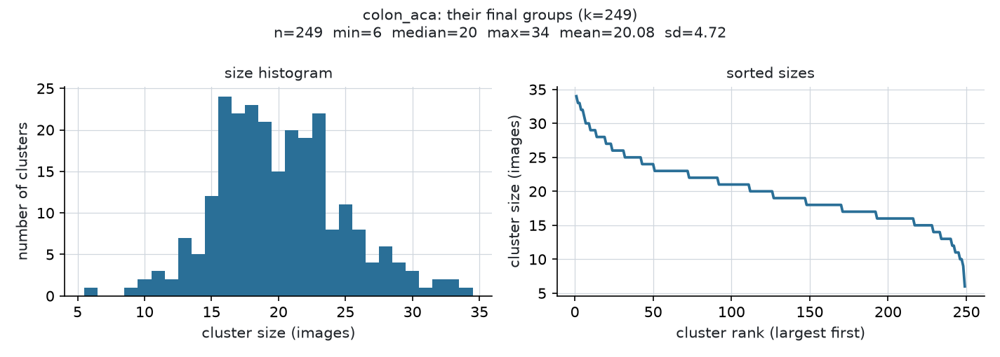
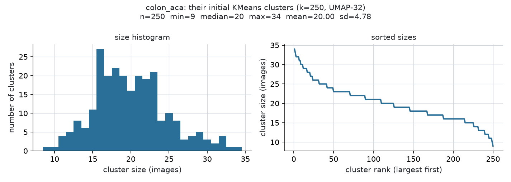
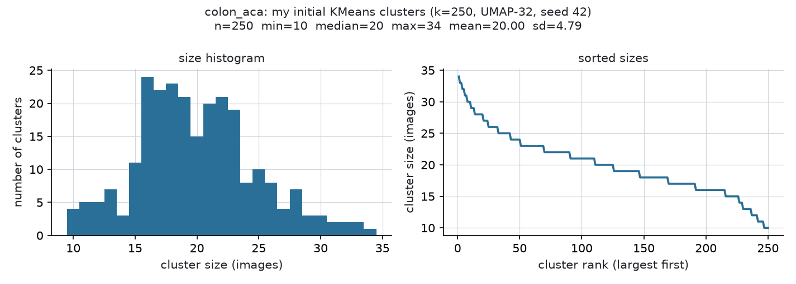
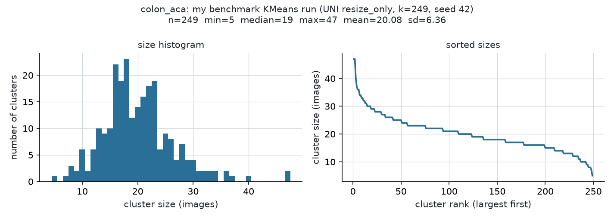
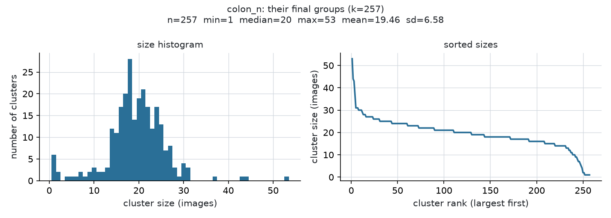
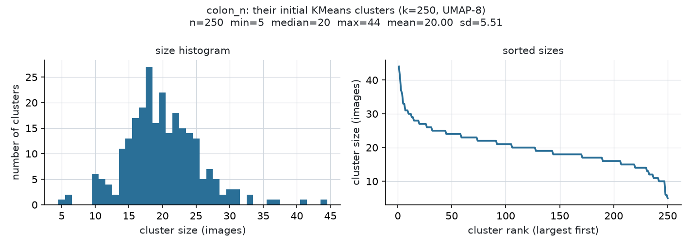
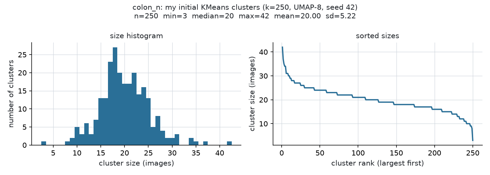
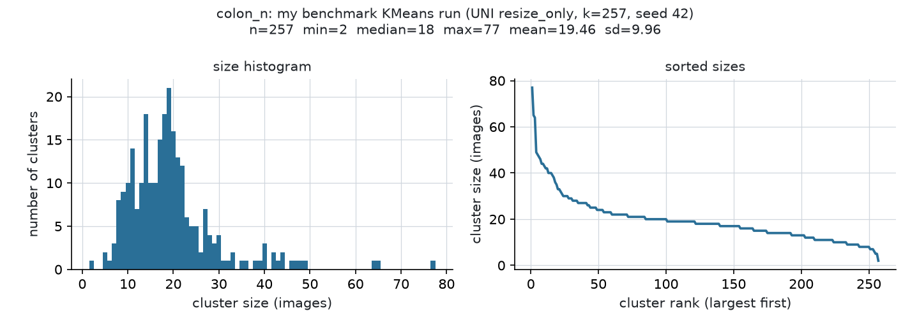

# Reproduction of Batchkala, Li & Rittscher (LC25000-clean) on colon_aca, next to colon_n

Same upstream commit `912f342`, same `venv_repro`, same patches as `repro/PATCHES.md` (none to upstream source), same criteria and thresholds as `repro/CRITERIA.md`.
colon_n columns are read from the existing colon_n outputs and never recomputed. Prov-Gigapath is not run here (Colab, later): its row is empty.

## 0. Setup

|  | colon_aca | colon_n |
|---|---|---|
| images | 5000 | 5000 |
| their final groups (`final_clusters.json`) | 249 | 257 |
| their saved initial clustering | UMAP-32 + KMeans k=250 | UMAP-8 + KMeans k=250 |
| their sklearn (from the .pkl) / n_init | 1.4.2 / auto | 1.4.2 / auto |
| my sklearn / n_init of my KMeans | 1.9.1 / auto | 1.9.1 / auto |

**The saved colon_aca clustering is UMAP-32, not UMAP-8.** The primary Phase 1 run for colon_aca therefore uses UMAP-32. A UMAP-8 run is reported separately and labelled "extra" for a like-for-like row against colon_n.

## 1. Criteria (thresholds unchanged from CRITERIA.md)

### C1: initial clusters reproduced (my seed-42 ARI vs their .pkl inside my own seed-to-seed band, mean ± 2 sd)

|  | colon_aca primary (UMAP-32) | colon_aca extra (UMAP-8) | colon_n (UMAP-8) |
|---|---|---|---|
| my seed-42 ARI vs their .pkl | 0.9720 | 0.9692 | 0.9308 |
| combined (UMAP+KMeans seeds 0..9) | 0.9738 ± 0.0052, band [0.9635, 0.9842]: PASS | 0.9785 ± 0.0043, band [0.9698, 0.9872]: FAIL | 0.9215 ± 0.0112, band [0.8991, 0.9438]: PASS |
| UMAP-only (KMeans fixed 42) | 0.9718 ± 0.0042, band [0.9633, 0.9803]: PASS | 0.9805 ± 0.0044, band [0.9717, 0.9893]: FAIL | 0.9295 ± 0.0081, band [0.9133, 0.9458]: PASS |
| KMeans-only (UMAP fixed 42) | 0.9788 ± 0.0048, band [0.9691, 0.9885]: PASS | 0.9817 ± 0.0045, band [0.9728, 0.9907]: FAIL | 0.9412 ± 0.0063, band [0.9286, 0.9538]: PASS |
| **C1** | PASS (3/3) | FAIL (0/3) | PASS (3/3) |

### C2: features reproduced (UNI resize_only benchmark row)

| metric | colon_aca theirs | colon_aca mine | colon_aca delta | bar | colon_aca result | colon_n delta | colon_n result |
|---|---|---|---|---|---|---|---|
| precision@1 | 1.00000 | 1.00000 | +0.00000 | 0.002 | PASS | +0.00000 | PASS |
| precision@5 | 0.99920 | 0.99916 | -0.00004 | 0.002 | PASS | -0.00008 | PASS |
| Adjusted Rand Index (ARI) | 0.89551 | 0.92318 | +0.02767 | 0.005 | FAIL | +0.00579 | FAIL |
| Fowlkes-Mallows Index | 0.89664 | 0.92372 | +0.02708 | 0.005 | FAIL | +0.00611 | FAIL |

## 2. Phase 1: initial clustering (UMAP + KMeans k=250, seed 42, upstream code)

|  | colon_aca primary (UMAP-32) | colon_aca extra (UMAP-8) | colon_n (UMAP-8) |
|---|---|---|---|
| ARI mine vs theirs | 0.9720 | 0.9692 | 0.9308 |
| AMI mine vs theirs | 0.9901 | 0.9895 | 0.9734 |
| clusters identical as image sets | 225/250 | 223/250 | 183/250 |
| images in Hungarian-matched cluster | 0.9660 | 0.9656 | 0.9338 |
| anchors equal to theirs | 25/250 | 20/250 | 25/250 |
| anchors equal within identical clusters | 23/225 | 18/223 | 23/183 |
| their anchor lies in my matched cluster | 242/250 | 242/250 | 235/250 |
| determinism: rerun seed 42 vs mine (ARI) | 1.0000 | 1.0000 | 1.0000 |
| my sizes min / median / max / sd | 10 / 20 / 34 / 4.79 | 7 / 19 / 34 / 4.77 | 3 / 20 / 42 / 5.22 |
| their sizes min / median / max / sd | 9 / 20 / 34 / 4.78 | 9 / 20 / 34 / 4.78 | 5 / 20 / 44 / 5.51 |
| sorted-size L1 distance | 34 | 34 | 64 |
| noise floor combined (ARI among my 10 runs) | 0.9738 ± 0.0052 | 0.9785 ± 0.0043 | 0.9215 ± 0.0112 |
| noise floor UMAP-only | 0.9718 ± 0.0042 | 0.9805 ± 0.0044 | 0.9295 ± 0.0081 |
| noise floor KMeans-only | 0.9788 ± 0.0048 | 0.9817 ± 0.0045 | 0.9412 ± 0.0063 |

## 3. Phase 2: rebuild of their final groups from their manual-review records

|  | colon_aca | colon_n |
|---|---|---|
| pre-merge clusters | 256 | 296 |
| accepted / rejected-pure clusters | 250 / 6 | 250 / 46 |
| final groups | 249 | 257 |
| merge operations implied | 7 | 39 |
| final groups made of >1 pre-merge cluster | 7 | 33 |
| rejected images | 58 | 265 |
| initial clusters with ≥1 rejected image | 6 | 38 |
| final groups equal to ONE initial cluster unchanged (fraction) | 231 (0.928) | 187 (0.728) |
| final groups equal to ONE pre-merge cluster (rejections allowed) | 242 (0.972) | 224 (0.872) |
| pre-merge clusters split across final groups | 0 | 0 |
| final groups that are not an exact union of pre-merge clusters | 0 | 0 |
| rejected-pure clusters that stay alone as a final group | 5 | 18 |
| rejected-pure clusters merged into an accepted cluster | 1 | 20 |
| merge composition | {"2acc+0rej": 6, "1acc+1rej": 1} | {"2acc+0rej": 12, "1acc+1rej": 16, "1acc+3rej": 1, "1acc+2rej": 3, "0acc+3rej": 1} |

## 4. Phase 3: benchmark (`evaluate_clustering.py`, NoReduction, euclidean, KMeans, k = 249 for colon_aca / 257 for colon_n)

| combo | colon_aca their ARI | colon_aca my ARI | colon_aca ΔARI | ΔFMI | ΔP@1 | ΔP@5 | colon_aca C2 (all 4 bars) | colon_n ΔARI | colon_n C2 |
|---|---|---|---|---|---|---|---|---|---|
| imagenet_resnet18-last-layer#resize_only | 0.4936 | 0.4735 | -0.0201 | -0.0191 | -0.0002 | +0.0002 | FAIL | -0.0098 | FAIL |
| imagenet_resnet18-last-layer#imagenet | 0.6347 | 0.6555 | +0.0209 | +0.0200 | -0.0002 | +0.0001 | FAIL | +0.0106 | FAIL |
| simclr-tcga-lung_resnet18-10x#imagenet | 0.6759 | 0.6840 | +0.0081 | +0.0080 | +0.0000 | +0.0000 | FAIL | -0.0086 | FAIL |
| UNI#resize_only | 0.8955 | 0.9232 | +0.0277 | +0.0271 | +0.0000 | -0.0000 | FAIL | +0.0058 | FAIL |
| UNI#imagenet | 0.8218 | 0.8109 | -0.0109 | -0.0106 | +0.0000 | -0.0000 | FAIL | +0.0155 | FAIL |
| simclr-tcga-lung_resnet18-2.5x#imagenet | 0.6197 | 0.6115 | -0.0082 | -0.0076 | +0.0000 | +0.0001 | FAIL | -0.0158 | FAIL |
| prov-gigapath#imagenet | 0.7937 | — | — | — | — | — | — (Colab, later) | — (Colab, later) | — |
| owkin-phikon#resize_only | 0.5894 | 0.5765 | -0.0129 | -0.0133 | +0.0000 | -0.0001 | FAIL | -0.0057 | FAIL |
| owkin-phikon#imagenet | 0.5202 | 0.5184 | -0.0018 | -0.0018 | +0.0000 | +0.0000 | PASS | -0.0013 | PASS |
| dinov2_vitb14#imagenet | 0.8051 | 0.7973 | -0.0079 | -0.0079 | +0.0000 | +0.0000 | FAIL | +0.0227 | FAIL |
| imagenet_resnet50-clam-extractor#imagenet | 0.6975 | 0.6959 | -0.0016 | -0.0015 | +0.0000 | +0.0000 | PASS | -0.0358 | FAIL |
| dinov2_vits14#imagenet | 0.7919 | 0.7715 | -0.0203 | -0.0205 | +0.0000 | -0.0002 | FAIL | -0.0174 | FAIL |

| summary over my combos | colon_aca | colon_n |
|---|---|---|
| P@1 and P@5 within 0.002 | 11/11 | 11/11 |
| ARI and FMI within 0.005 | 2/11 | 1/11 |
| mean abs ΔARI | 0.0128 | 0.0135 |
| max abs ΔARI | 0.0277 | 0.0358 |
| all four bars | 2/11 | 1/11 |

## 5. KMeans seed / n_init spread (UNI resize_only, NoReduction, seeds 0..9, scored vs their final groups)

| KMeans | metric | colon_aca mean ± sd [min, max] | colon_aca theirs | colon_aca z | colon_aca runs ≥ theirs | colon_n mean ± sd | colon_n theirs | colon_n z | colon_n runs ≥ theirs |
|---|---|---|---|---|---|---|---|---|---|
| n_init=auto | ARI | 0.9110 ± 0.0143 [0.8777, 0.9274] | 0.89551 | -1.08 | 9/10 | 0.6628 ± 0.0110 | 0.63765 | -2.29 | 10/10 |
| n_init=auto | FMI | 0.9118 ± 0.0139 [0.8793, 0.9279] | 0.89664 | -1.09 | 9/10 | 0.6650 ± 0.0108 | 0.64027 | -2.30 | 10/10 |
| n_init=10 | ARI | 0.9274 ± 0.0068 [0.9196, 0.9388] | 0.89551 | -4.68 | 10/10 | 0.6781 ± 0.0156 | 0.63765 | -2.59 | 10/10 |
| n_init=10 | FMI | 0.9280 ± 0.0067 [0.9203, 0.9392] | 0.89664 | -4.68 | 10/10 | 0.6802 ± 0.0154 | 0.64027 | -2.59 | 10/10 |

Per-combo seed noise (n_init default, seeds 0..9) in context of their published ARI:

| combo | colon_aca their ARI | colon_aca my seeds mean ± sd | colon_aca z | colon_aca within 2 sd | colon_n z | colon_n within 2 sd |
|---|---|---|---|---|---|---|
| UNI#imagenet | 0.8218 | 0.8378 ± 0.0110 | -1.45 | yes | -0.50 | yes |
| UNI#resize_only | 0.8955 | 0.9110 ± 0.0143 | -1.08 | yes | -2.29 | no |
| dinov2_vitb14#imagenet | 0.8051 | 0.7968 ± 0.0205 | +0.41 | yes | -1.04 | yes |
| dinov2_vits14#imagenet | 0.7919 | 0.7960 ± 0.0192 | -0.21 | yes | -0.98 | yes |
| imagenet_resnet18-last-layer#imagenet | 0.6347 | 0.6388 ± 0.0142 | -0.29 | yes | +0.02 | yes |
| imagenet_resnet18-last-layer#resize_only | 0.4936 | 0.4793 ± 0.0111 | +1.28 | yes | +2.73 | no |
| imagenet_resnet50-clam-extractor#imagenet | 0.6975 | 0.6866 ± 0.0089 | +1.23 | yes | +2.36 | no |
| owkin-phikon#imagenet | 0.5202 | 0.5145 ± 0.0131 | +0.44 | yes | +0.82 | yes |
| owkin-phikon#resize_only | 0.5894 | 0.5943 ± 0.0166 | -0.29 | yes | +0.51 | yes |
| simclr-tcga-lung_resnet18-10x#imagenet | 0.6759 | 0.6597 ± 0.0114 | +1.42 | yes | -0.01 | yes |
| simclr-tcga-lung_resnet18-2.5x#imagenet | 0.6197 | 0.6202 ± 0.0153 | -0.03 | yes | +0.43 | yes |

## 6. k = 249 (their group count) vs k = 250 (UNI resize_only, scored vs their final groups)

| class | k | ARI (seed 42) | FMI | NMI | ARI seeds 0..9 mean ± sd |
|---|---|---|---|---|---|
| colon_aca | k=249 | 0.9232 | 0.9237 | 0.9845 | 0.9110 ± 0.0143 |
| colon_aca | k=250 | 0.9253 | 0.9258 | 0.9849 | 0.9122 ± 0.0133 |
| colon_n | k=257 | 0.6434 | 0.6464 | 0.9154 | 0.6628 ± 0.0110 |
| colon_n | k=250 | 0.6401 | 0.6437 | 0.9136 | 0.6597 ± 0.0128 |

## 7. My four old arms re-scored with their metric functions

| arm | colon_aca: upstream pipeline k=249, ARI | colon_aca: my old k=250 labels, ARI | colon_n: upstream pipeline k=257, ARI | colon_n: my old k=250 labels, ARI |
|---|---|---|---|---|
| uni1_full | 0.8416 | 0.8571 | 0.4392 | 0.4653 |
| uni1_pca128 | 0.7918 | 0.8172 | 0.4496 | 0.4310 |
| resnet50_full | 0.6389 | 0.6711 | 0.4472 | 0.4304 |
| resnet50_pca128 | 0.6586 | 0.6741 | 0.4301 | 0.4523 |

## 8. Cluster-size distributions

Four distributions per class: their final groups, their initial 250, my initial 250, my benchmark KMeans run (UNI resize_only, k = group count, seed 42). Figures: `repro/figs/colon_aca/` and `repro/figs/colon_n/`.
The colon_n "my benchmark KMeans run" sizes were not stored; they were re-derived in memory from the existing feature vectors (ARI 0.64344 equals stored benchmark value). colon_aca: ARI 0.92318 equals stored benchmark value.

## 9. Runtimes (wall clock on this machine, 20 cores, CPU only)

| phase | step (colon_aca) | seconds | minutes | exit |
|---|---|---|---|---|
| 1a | extract_imagenet_resnet18-last-layer_resize_only | 103 | 1.7 | 0 |
| 1a | extract_UNI_resize_only | 2139 | 35.6 | 0 |
| 1b | stage_a_initial_clustering | 83 | 1.4 | 0 |
| 1b | stage_a_extra_anchors | 0 | 0.0 | 0 |
| 1b | stage_a_umap_only_noise | 68 | 1.1 | 0 |
| 1b | stage_a_initial_clustering_umap8 | 67 | 1.1 | 0 |
| 1b | stage_a_extra_anchors_umap8 | 0 | 0.0 | 0 |
| 1b | stage_a_umap_only_noise_umap8 | 58 | 1.0 | 0 |
| 2 | stage_b_rebuild_groups | 0 | 0.0 | 0 |
| 3a | run_extractions_resume2 | 2203 | 36.7 | 0 |
| 3b | evaluate_clustering | 75 | 1.2 | 0 |
| 3b | stage_d_compare_benchmark | 0 | 0.0 | 0 |
| 3c | stage_c_kmeans_seeds_uni | 314 | 5.2 | 0 |
| 3c | stage_c_extras | 107 | 1.8 | 0 |
| 3c | stage_d_kmeans_seeds_all | 221 | 3.7 | 0 |
| 4 | criteria_check | 0 | 0.0 | 0 |
| 4 | criteria_check_umap8 | 0 | 0.0 | 0 |
|  | **total of the steps above** | 5438 | 90.6 |  |

Feature extraction per combo (from the `run_extractions` log timestamps; `extract_*` rows above are the two Phase 1 extractions run directly):

| combo | colon_aca minutes | colon_n minutes |
|---|---|---|
| UNI imagenet | 36.7 | 603.4 |
| dinov2_vitb14 imagenet | 17.0 | 17.4 |
| dinov2_vits14 imagenet | 5.3 | 21.1 |
| imagenet_resnet18-last-layer imagenet | 1.8 | 2.0 |
| imagenet_resnet18-last-layer resize_only |  | 2.2 |
| imagenet_resnet50-clam-extractor imagenet | 4.0 | 10.6 |
| owkin-phikon imagenet | 12.0 | 12.7 |
| owkin-phikon resize_only | 11.9 | 17.0 |
| simclr-tcga-lung_resnet18-10x imagenet | 1.8 | 1.9 |
| simclr-tcga-lung_resnet18-2.5x imagenet | 1.8 | 2.0 |

Interruptions during the UNI#imagenet extraction (it saves features only at the end, so each kill lost the whole run):

- 3a attempt 1 was killed when the Claude session ended (UNI imagenet at 14%, 00:16 on 2026-11-20, nothing saved); resumed 2026-11-21
- 3a attempt 2 (resume 1) was killed at 93% (08:01 on 2026-11-21) when the session ended again; resumed under a user-level systemd service

The UNI#imagenet time in the tables is from the final clean run (a user-level systemd service). `repro/logs/colon_aca/run_extractions_part1.log` and `run_extractions_resume1_killed.log` keep the logs of the killed attempts.

colon_n timings exist only for extractions run through `run_extractions.sh`; its UNI#imagenet figure spans an overnight pause and is not a compute time. Other colon_n steps were not timed.

## 10. Versions

| package | version |
|---|---|
| python | 3.12.3 |
| torch | 2.14.1+cpu |
| torchvision | 0.29.1+cpu |
| timm | 1.0.30 |
| numpy | 2.5.2 |
| scikit-learn | 1.9.1 |
| umap-learn | 0.5.12 |
| scipy | 1.18.1 |
| pandas | 3.1.0 |
| matplotlib | 3.11.2 |
| transformers | 5.20.2 |
| huggingface_hub | 2.2.0 |
| numba | 0.68.0 |
| pynndescent | 0.6.0 |
| their .pkl sklearn | 1.4.2 |
| upstream commit | 912f342fe2a781e847f395d79982dad4d3d425ae |

## 11. colon_n integrity (hash report)

- `markers/colon_n_repro_hashes_before.txt`: 5143/5143 files identical, 0 different or missing: none.
- Covered: `repro/out/**`, `repro/scratch_eval*/**`, `repro/logs/*` (top level), the `repro/*.md|txt|ipynb` docs, `install.sh`, upstream `feature_vectors/colon_n/**`, `eval_results/**`, `annotations/**`, and the 5000 colon_n originals.
- colon_n scripts re-run with `REPRO_OUT_ROOT` against a scratch copy of `repro/out` reproduced `phase2_metrics.json`, `pre_merge_clusters.json`, `anchor_extra.json`, `criteria_check.json` and `phase3_compare.csv` byte for byte after the `--cls` change.
- New, not checked:
  - `repro/figs/colon_n/sizes_their_final.png`
  - `repro/figs/colon_n/sizes_their_initial250.png`
  - `repro/figs/colon_n/sizes_my_initial250.png`
  - `repro/figs/colon_n/sizes_my_benchmark_kmeans.png`

## 12. What differs from colon_n (read before comparing numbers)

- Their colon_aca initial clustering is UMAP-32; colon_n is UMAP-8. The extra UMAP-8 columns give a like-for-like row.
- Their colon_aca review is much lighter: 58 rejected images in 6 clusters, against 265 in 38 for colon_n.
- Prov-Gigapath was not run locally for either class (no local features for colon_n either; it needs Colab). The colon_aca row is empty by design.
